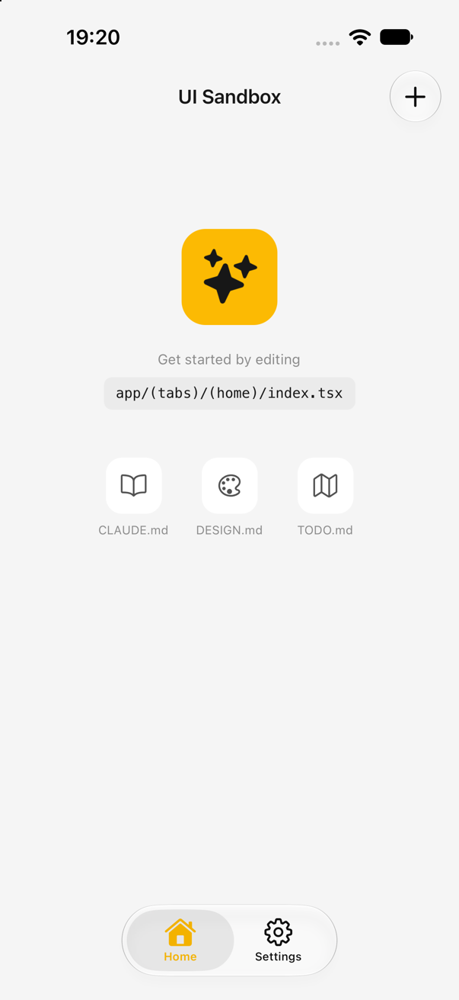

# create-mt-app

Scaffold an Expo app with my standard stack in one command — always on the **latest** package versions (nothing is pinned in the template; `expo install` resolves SDK-compatible versions at scaffold time), with a rich `CLAUDE.md` so AI-assisted work follows the house conventions from the first prompt.

<p align="center">
  
</p>

## Usage

```bash
npm create mt-app                  # interactive
npm create mt-app -- "My App" --yes
node dist/index.js "My App" --yes  # from a local checkout
```

| Flag | Meaning |
|---|---|
| `--yes` / `-y` | Accept all defaults (name still required) |
| `--dir <path>` | Target directory (default `~/Projects/<slug>`) |
| `--feature <name>` | Primary feature module name (default `items`) |
| `--accent <hex>` | Accent color (default `#fcba03`) |
| `--skip-install` | Write files only — no installs, migrations, or checks |
| `--skip-git` | Don't `git init` + commit |

## What it generates

- **Expo latest SDK** — Expo Router (typed routes, react compiler), new architecture
- **NativeWind v4** — semantic tokens (`surface/text/border/accent`) as CSS vars + runtime palette, dark mode via persisted preference
- **Drizzle + expo-sqlite** — generated migrations applied at boot (`useMigrations` gate), live queries
- **Zod v4 + react-hook-form** — per-feature `schema.ts` with lazy i18n error thunks, `zodResolver`
- **Zustand 5** — one persisted preferences store; entity state stays in SQLite
- **i18next** — en/es, `ThemeSync`/`LanguageSync`/`WidgetSync` provider pattern
- **expo-widgets** — TSX home-screen widget (`"widget"` directive, @expo/ui/swift-ui) fed by `WidgetSync`
- **RevenueCat** — purchases feature module, `useIsPro()`, custom paywall modal route
- **AdMob** — `AdBanner` slot (hidden for Pro, non-personalized so no ATT prompt), test ads in dev, disabled until per-platform unit ids land in `.env`
- **Native navigation** — `NativeTabs` liquid-glass tab bar (iOS 26), a native stack per tab with inline titles, header actions as native `Stack.Toolbar` buttons
- **UI primitives** — floating-label `Field`, inset-grouped `ListSection`/`ListRow`, `Card`, `Button`, `Screen`, loading/error/empty state views
- **Get-started Home** — animated dev-only placeholder as Home's empty state ("edit `app/(tabs)/(home)/index.tsx`"); swap in `EmptyState` when you build the screen
- **Reanimated 4 motion** — `src/ui/motion.ts` duration/spring tokens, `usePressScale()` on `Button`, animated list layout and onboarding page dots, Reduce Motion rules
- **Pulsar haptics** — `src/features/haptics/` intent vocabulary (press/tick/toggle/success/destructive/celebrate) over `react-native-pulsar`, safe lazy native-module probe, `useMomentHaptic`, `HapticsSync` + Settings → Feel toggle, dev sampler + simulator sound, jest mock wired
- **Onboarding** — skippable paged intro gated by a persisted flag, ending in a create-your-first-X CTA
- **Reviews** — `review-prompt.ts` (happy-moment `maybeRequestReview` + Settings "Leave a review")
- **Settings** — theme/language pickers, Pro + restore, review, privacy policy (matiasturra.dev/privacy/&lt;slug&gt;), replay onboarding, version from app.json
- **Biome + Jest** — lint/format + pure-logic tests
- **EAS + expo-release** — build profiles, `store.config.json` (en-US/es-ES)
- **CLAUDE.md + DESIGN.md** — the full convention spec (data states, cancellability, kebab-case, composition over monolith screens, safe areas, expandable lists) and the design-system token contract (incl. voice & tone + App Store screenshot headlines), including the RevenueCat/paywall recipe
- **Shipping workflow** — `docs/spec-template.md` (spec-first development), `TODO.md` living roadmap (easiest→hardest phases, early Pro pivot, app-store readiness checklist), `AGENTS.md` pinned to the installed SDK's docs, ErrorBoundary, `__DEV__` DeveloperSection for screenshot staging, `skills-lock.json`, `.claude/settings.json` (expo plugin), and the no-analytics-by-design position

## Guidelines baked in

Spelled out in the generated `CLAUDE.md` and `DESIGN.md`:

- **Spec first** — features start as `docs/spec-*.md`; `TODO.md` roadmap ordered easiest → hardest
- **Scaffold the seam** — don't build what v1.0 doesn't need
- **Thin routes** — logic lives in feature modules (`schema` / `queries` / `form`); screens are compositions
- **Tokens only** — no hex or pixel values; dark mode and en/es from day one
- **Every async region** renders loading, error and empty
- **Native look** — liquid-glass tabs and headers, floating-label forms, inset-grouped lists
- **Motion** from tokens, transform/opacity only, Reduce Motion respected
- **Haptics** through named intents with one global toggle
- **Flows are cancellable**; destructive actions confirm
- **Kebab-case files**, Biome, pure-logic tests, conventional commits
- **No analytics or crash reporting**, by design

## Pipeline

1. Render `template/` into the target dir (token substitution in contents and file names; `__FEATURE__` names the feature module, table, and routes)
2. `npm install expo@latest`, then `npx expo install` for SDK-managed packages, then `@latest` for pure-JS libraries
3. `npx drizzle-kit generate` — initial migration from the schema
4. Verify: `tsc --noEmit`, `jest`, `biome check` (failures are reported, not hidden)
5. `git init` + initial commit

## Development

```bash
npm install
npm run build     # tsc -> dist/
node dist/index.js "Test App" --yes --skip-install --dir /tmp/test-app
```

Templates live in `template/` — placeholder tokens are documented in `src/config.ts` (`buildTokens`). Dotfiles that npm would strip are stored with a `_` prefix (`_gitignore` → `.gitignore`).
